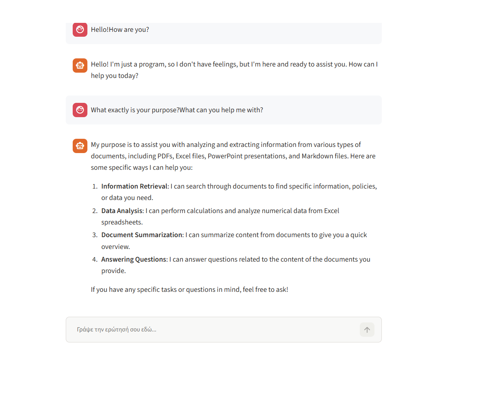
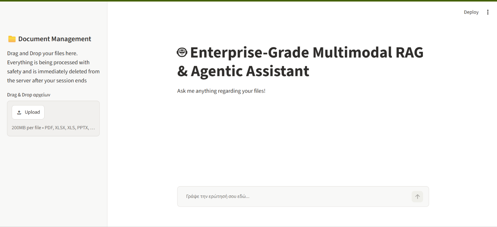
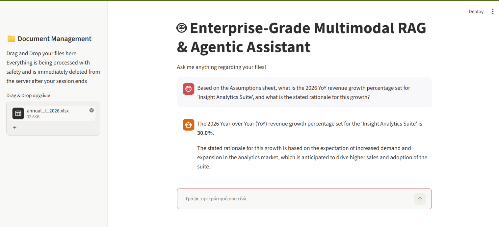
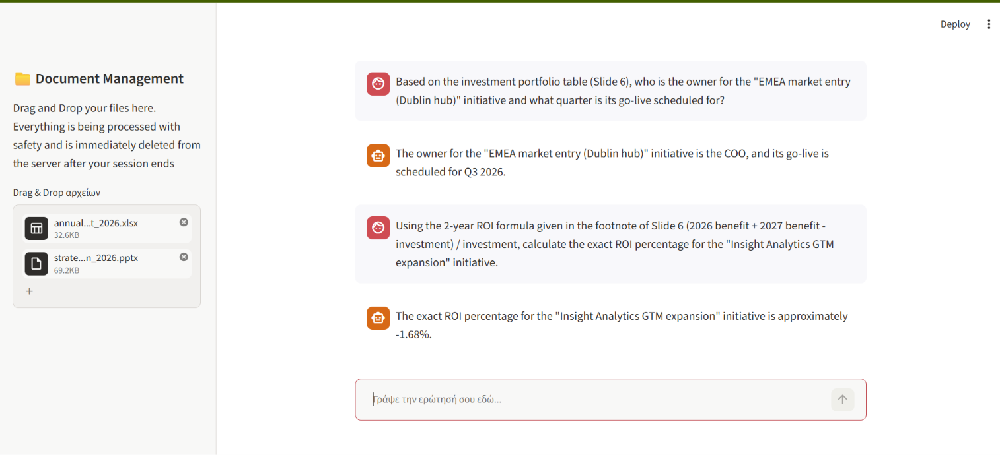
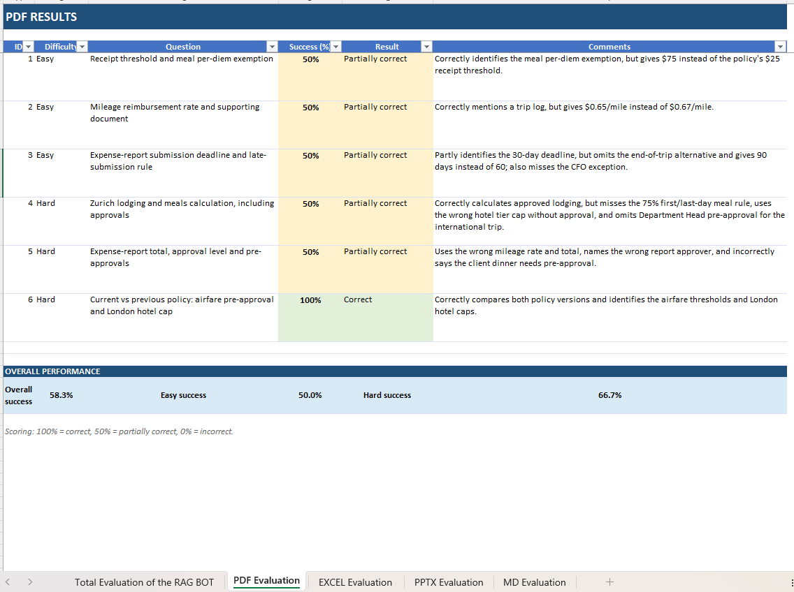
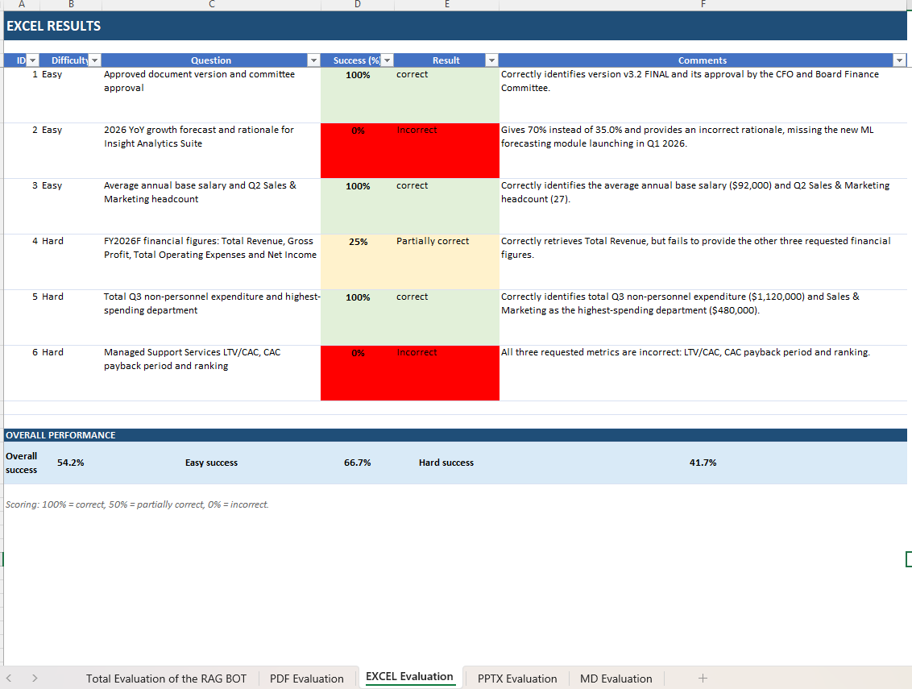
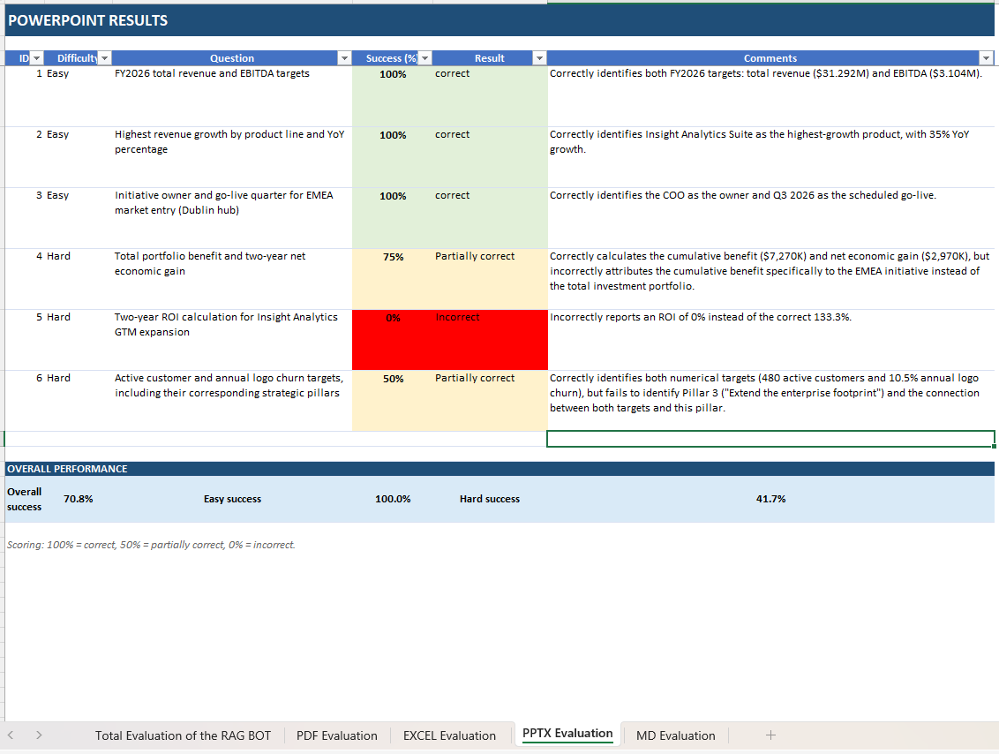
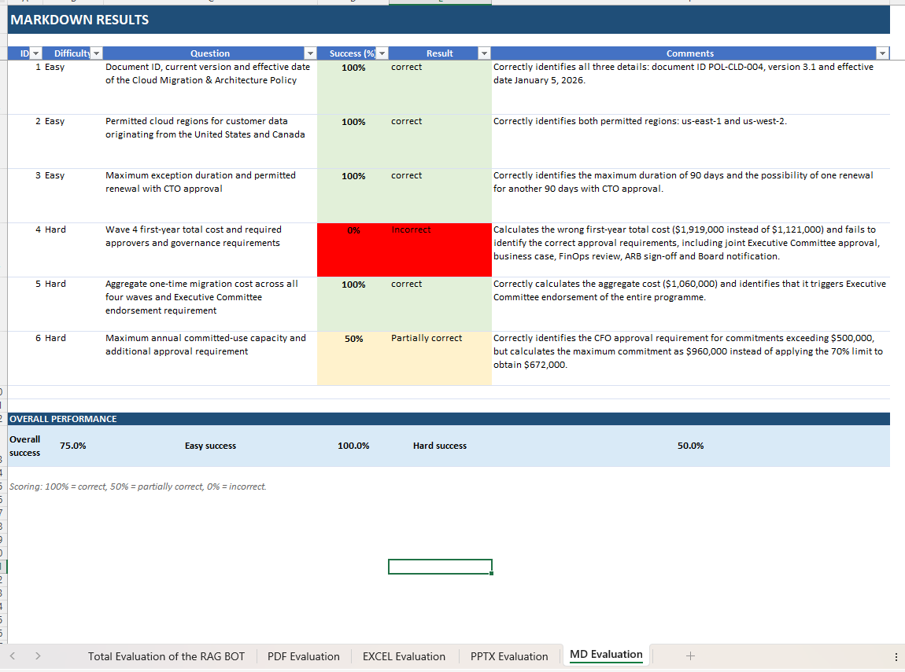
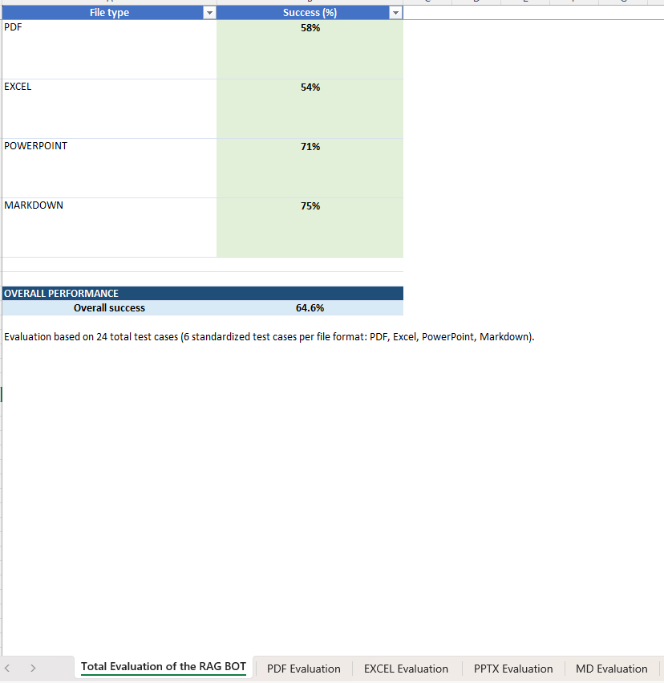

# Enterprise-Grade Multimodal RAG & Agentic Assistant

This repository contains a production-ready, enterprise-grade Retrieval-Augmented Generation (RAG) and Agentic Assistant application built with Streamlit, LangChain, and Supabase (pgvector).
A secure AI assistant that lets you chat naturally with your corporate documents like PDFs, Excel sheets, and presentations.
It combines smart vector search with an integrated calculator to provide accurate data analysis and precise answers.
Built for enterprise privacy with zero permanent server storage and automated background database cleanups.

## Contents
- [Steps to set up and run the project](#steps-to-set-up-and-run-the-project)
  - [Prerequisites](#⚙️-prerequisites)
  - [Setup and Installation](#-setup-and-installation)
  - [Running the Application](#-running-the-application)
- [Tools/Techs that have been used](#toolstechs-that-have-been-used)
- [Interface](#interface)
  - [Main Chat interface](#-main-chat-interface)
  - [Files Drag and Drop](#-files-drag-and-drop-)
- [Core Architecture & Component Breakdown](#core-architecture--component-breakdown)
  - [1. Multimodal Document Ingestion Pipeline](#1-multimodal-document-ingestion-pipelineingestionpy)
  - [2. Vector Store & Chunking Management](#2-vector-store--chunking-management-vectorstorepy)
  - [3. Agentic Workflow & Custom Tools](#3-agentic-workflow--custom-tools-agentpy)
  - [4. Streamlit User Interface & Ephemeral Handling](#4-streamlit-user-interface--ephemeral-handling-apppy)
  - [5. Automated Evaluation Framework](#5-automated-evaluation-framework-evaluationpy)
- [Security & Privacy Architecture](#security--privacy-architecture)
- [⚠️ Evaluation Baseline & Roadmap (Work-in-Progress)](#️-evaluation-baseline--roadmap-work-in-progress)
  - [Pdf evaluation results](#-pdf-evaluation-results)
  - [Excel evaluation results](#-excel-evaluation-results)
  - [Powerpoint evaluation results](#-powerpoint-evaluation-results)
  - [Markdown evaluation results](#-markdown-evaluation-results-)
- [Project File Structure](#project-file-structure)
- [Containerization (Dockerfile)](#containerization-dockerfile)


## Steps to set up and run the project

### ⚙️ Prerequisites

Before you begin, ensure you have the following installed on your machine:

* **Python** : version 3.12 or higher recommended

* **Git**: for cloning the repository

* **Supabase**: a Supabase project with the vector and pg_cron extensions enabled


### 🚀 Setup and Installation

Follow these steps to set up the project locally:

🔷 **Step 1: Clone the Repository::** 

```
git clone https://github.com/your-github-username/enterprise-rag-assistant.git
cd enterprise-rag-assistant
```

🔷 **Step 2: Create a Virtual Environment and Install Dependencies:**
Create a copy of the .env.example file and name it .env. This file holds all your environment variables, including database credentials and API keys.


```
python -m venv venv
# On macOS / Linux:
source venv/bin/activate
# On Windows (CMD / PowerShell):
venv\Scripts\activate

pip install -r requirements.txt
```


🔷 **Step 3: Configure Environment Variables:**
Create a copy of .env.example and name it .env:
```
cp .env.example .env
```

Populate your .env file with your credentials:
```
SUPABASE_URL=your_supabase_url_here
SUPABASE_SERVICE_KEY=your_supabase_service_key_here
OPENAI_API_KEY=your_openai_api_key_here
```


🔷 **Step 4: Configure Supabase Database & Automated Cleanup:**
Open your Supabase project dashboard, navigate to the SQL Editor, and run the following commands to enable necessary extensions and configure automated background cleanup of temporary documents older than 12 hours:

```
create extension if not exists vector;
create extension if not exists pg_cron;

select cron.schedule(
  'auto-cleanup-rag-docs',
  '0 */12 * * *', 
  $$
  DELETE FROM documents 
  WHERE created_at < NOW() - INTERVAL '12 hours';
  $$
);
```


### 🖥️ Running the Application
Start the Streamlit interface locally:

```
streamlit run app.py
```

The application will open automatically in your browser at http://localhost:8501.   


## Tools/Techs that have been used
Summary of tools used:
* Frontend & UI:: **Streamlit** (interactive chat interface and dynamic file management sidebar).
* Orchestration & Agents: **LangChain / LangGraph** (tool-calling agents, prompt templates, and conversational session history).
* Vector Database & Storage: **Supabase / PostgreSQL** (pgvector for similarity search via cosine distance, pg_cron for TTL maintenance).
* Document Parsing: **Unstructured API** (hi_res strategy with YOLOX model and table structure inference for complex PDFs), **Pandas** (for excel sheets), **partition_pptx** (for powerpoint), **partition_md** (for markdown)
* AI Models: **OpenAI** (gpt-4o-mini for agentic reasoning and table summarization; text-embedding-3-small for vector embeddings).
* Containerization: **Docker** (slim Python image pre-configured with system OCR and document binaries).


## Interface

### 🔷 Main Chat interface: 




### 🔷 Files Drag and Drop : 





* An example of a question on a dropped excel file:




* An example of a question on a dropped excel file and a powerpoint file :





## Core Architecture & Component Breakdown

### 1. Multimodal Document Ingestion Pipeline(ingestion.py)
The ingestion pipeline is handled by the DocumentIngestionPipeline class, which dynamically scans uploaded documents and applies tailored parsing strategies depending on the file format:

* **Complex PDFs (load_complex_pdf)** : Utilizes local hi_res partitioning powered by the YOLOX layout detection model (pdf_infer_table_structure=True). Detected tables are converted into structured HTML representations ([TABLE HTML]...[/TABLE HTML]) to preserve exact row-column relationships, while document headers and reference sections are filtered out to reduce retrieval noise.

* **Excel Spreadsheets (load_excel_as_elements)** : Reads all sheets via Pandas, cleans empty rows/columns, and converts each sheet into a clean HTML table. Crucially, it leverages gpt-4o-mini (temperature=0.0) to generate a comprehensive semantic summary for every table. Both the AI summary and the raw HTML table are combined into a single Table element—allowing vector search to match natural language queries via the summary while providing exact numerical cells to the agent via HTML

* **PowerPoint & Markdown (load_powerpoint, load_markdown):** : Uses native partition_pptx and partition_md functions from the unstructured library to extract slide text and markdown blocks while retaining document structure


### 2. Vector Store & Chunking Management (vectorstore.py)
Managed by the SupabaseVectorStoreManager class, this module bridges document parsing with cloud vector storage:   

* **Title-Based Chunking**: Applies chunk_by_title from the unstructured library to segment parsed elements into coherent, context-preserving chunks.   

* **Metadata Sanitization**: Converts elements into standard LangChain Document objects, maps filenames to a standardized source key, and strips incompatible list fields (such as languages) to prevent database insertion errors.   

* **Supabase (pgvector) Integration**: Embeds chunks using OpenAI's text-embedding-3-small model and stores them in the documents PostgreSQL table via SupabaseVectorStore. Similarity retrieval is configured to fetch the top $k=6$ most relevant chunks using cosine similarity (match_documents RPC). 

### 3. Agentic Workflow & Custom Tools (agent.py)
The EnterpriseAgentManager class builds an autonomous tool-calling agent powered by gpt-4o-mini (temperature=0) using LangChain's create_tool_calling_agent and AgentExecutor:   

* **System Prompt Engineering**: Instructs the agent to strictly rely on retrieved context, acknowledge when information is missing rather than guessing, and carefully inspect <thead> and <tbody> tags when reading HTML tables to avoid confusing totals with unit metrics.   

* **Custom Tool 1 — search_documents** : Invokes the Supabase retriever to fetch and concatenate relevant document chunks across PDFs, Excel sheets, presentations, and markdown files.   

* **Custom Tool 2 — calculate_math** : A sandboxed Python mathematical evaluator (eval with __builtins__ disabled) that allows the agent to execute exact arithmetic operations, ratios, and percentage changes derived from financial tables instead of relying on LLM mental math. 


### 4. Streamlit User Interface & Ephemeral Handling (app.py)
The user interface is built with Streamlit and engineered for seamless interaction and state management:

* **Automated Ingestion Trigger** : Dragging and dropping files into the sidebar automatically triggers the ingestion and vector embedding pipeline without requiring a manual "Process" button. A file signature check (processed_files_sig storing file names and sizes in st.session_state) ensures files are only processed once per upload.

* **Conversational Memory** : Maintains multi-turn dialogue context using st.session_state.chat_history (HumanMessage and AIMessage objects) and caches the initialized AgentExecutor via @st.cache_resource for fast responses.


### 5. Automated Evaluation Framework (evaluation.py)
The project includes a dedicated evaluation pipeline (run_rag_evaluation) built around a structured test suite of 24 test cases spanning all four supported file formats (PDF, Excel, PowerPoint, and Markdown) across two difficulty tiers:

* **Simple Lookups** : Direct factual and single-cell retrieval queries.


## Security & Privacy Architecture
This system is designed with strict data privacy and zero-trust principles for handling sensitive corporate files:

* **Zero Permanent Disk Footprint (tempfile)**: Uploaded files are never saved to a permanent data/ directory on the server. Instead, app.py writes uploaded buffers inside a tempfile.TemporaryDirectory() context manager. The moment the ingestion and embedding pipeline finishes, the temporary directory and all raw files are automatically and permanently destroyed from the server disk.

* **Automated Database Lifecycle (pg_cron)** : Rather than relying on unreliable browser-close events in stateless web sessions, data retention in Supabase is enforced at the database level. A scheduled PostgreSQL pg_cron background job (auto-cleanup-rag-docs) runs every 12 hours to automatically purge expired vector records (created_at < NOW() - INTERVAL '12 hours').

* **Sandboxed Tool Execution** : The mathematical calculation tool strips all Python built-ins ({"__builtins__": {}}) during eval() execution, preventing arbitrary code injection.


## ⚠️ Evaluation Baseline & Roadmap (Work-in-Progress)
I tested the assistant against a custom 24-question benchmark across all four file formats to establish a realistic starting point. Right now, it achieves an overall accuracy of **64.6%** (**79.2%** on simple lookups, dropping to **50.0%** on complex multi-step calculations and dense tables). While the current score isn't production-ready yet—mostly due to occasional missing chunks in complex financial tables—this is an active **work-in-progress**, and the diagnostic Excel sheet below helps pinpoint exactly where retrieval needs to be improved next.


### 🔷 Pdf evaluation results: 




### 🔷 Excel evaluation results: 




### 🔷 Powerpoint evaluation results:




### 🔷 Markdown evaluation results : 




### 🔷 Total evaluation results : 




## Project File Structure

```
enterprise-rag-assistant/
│
├── data/                      # Local directory for sample/test documents (PDF, XLSX, PPTX, MD)
├── screenshots/               # UI and evaluation screenshots for documentation
├── src/                       # Core application source code
│   ├── __init__.py
│   ├── ingestion.py           # Multimodal document parsing (YOLOX PDF, Pandas Excel, PPTX, MD)
│   ├── vectorstore.py         # Supabase pgvector connection, chunking, and OpenAI embeddings
│   ├── agent.py               # LangChain tool-calling agent & custom tools (RAG search + math)
│   └── evaluation.py          # Automated benchmark script and 24-case test suite
│
├── app.py                     # Streamlit UI, session state management, and ephemeral file handling
├── requirements.txt           # Pinned Python dependencies
├── Dockerfile                 # Multi-layer slim container build with OCR & PDF system binaries
├── .env.example               # Template for required environment variables (OpenAI & Supabase)
└── README.md                  # Project documentation

```


